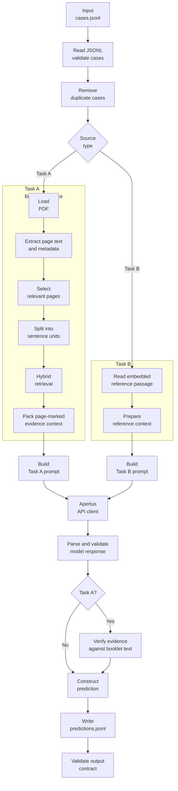
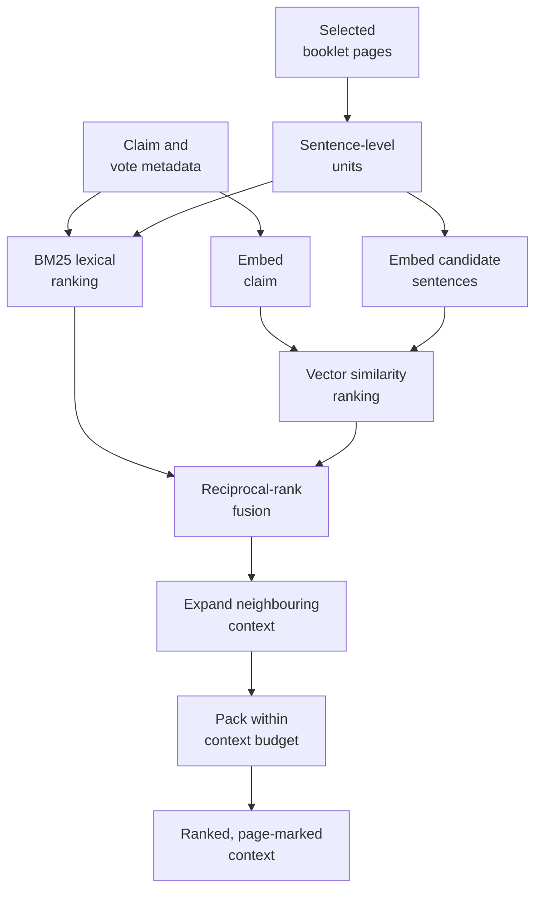
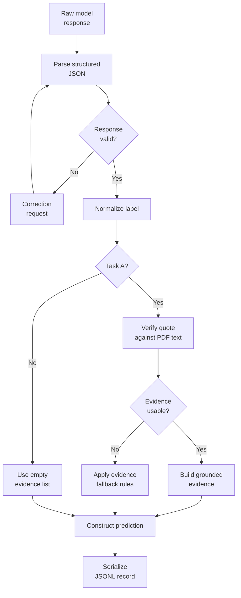
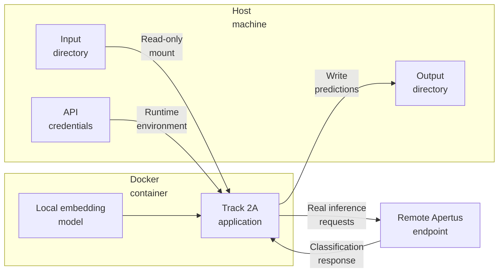

# Architecture

## 1. System overview

Track 2A is a multilingual natural-language inference system that determines whether a claim is supported by, unrelated to, or contradicted by a source. The source is either an official Swiss voting-booklet PDF (Task A) or a reference passage provided directly in the input (Task B).

The architecture separates the system into five logical layers:

1. **Input handling** — reads JSONL cases, validates their structure, and removes duplicate cases.
2. **Source processing** — extracts and organizes PDF text for Task A, while Task B uses its embedded reference passage.
3. **Evidence retrieval** — selects relevant booklet content using lexical and multilingual semantic retrieval.
4. **Inference** — sends the claim and its source context to the appropriate Apertus model through an API-compatible client.
5. **Validation and output** — parses the prediction, validates evidence where applicable, and writes a structured JSONL response.

PDF extraction, retrieval, evidence verification, and output construction run locally. Only the language-model inference requests are sent to the configured remote endpoint during real inference.

## 2. High-level architecture

The two tasks share input handling, model communication, response parsing, and output construction. They differ primarily in how source context is obtained and whether the prediction must contain verified PDF evidence.

## 3. Input and orchestration layer

The pipeline accepts one JSON object per line in `cases.jsonl`. Each case identifies the claim and the source information required for its task.

The input layer reads the file, rejects malformed or structurally invalid records, and removes duplicate cases according to the runtime cleaning rules. Valid cases are processed independently, allowing a failure in one case to be logged without necessarily stopping the entire run.

The orchestrator determines which processing path to use:

- **Task A:** a booklet PDF must be resolved and read before inference.
- **Task B:** the reference passage is already present in the case and can be used directly.

Each path produces source context for classification. The orchestrator then coordinates inference, response parsing, evidence handling, and final response construction.

## 4. Task A architecture: PDF evidence retrieval

Task A must identify relevant evidence inside a voting booklet before asking the language model to classify a claim. The PDF is processed locally to avoid sending the entire document to the language model.

### 4.1 PDF extraction and page selection

The system opens the booklet with PyMuPDF and extracts text while preserving physical page numbers. Page identity is important because evidence must be traceable to the original document.

The system uses vote-title information to score and select potentially relevant pages. Where available, PDF outline or contents information provides section metadata that helps preserve document structure.

Page selection narrows the search space before sentence-level retrieval. It is a candidate-selection step, not proof that the selected pages contain the answer.

### 4.2 Sentence-level representation

Text from the selected pages is divided into sentence-level units. Each unit retains its page association and relevant section metadata.

This representation allows the retriever to rank concise pieces of evidence rather than treating the entire booklet as one large text block. Retaining page associations also makes later evidence verification possible.

### 4.3 Hybrid retrieval

The retriever combines two complementary signals:

- **Lexical retrieval:** BM25 ranks text based on term overlap and relevance.
- **Semantic retrieval:** multilingual embeddings represent the claim and candidate text in vector space, enabling retrieval when relevant passages use different wording.

The ranked lists are combined using reciprocal-rank fusion. This reduces dependence on either exact word matching or semantic similarity alone.

After ranking, the system expands selected units with neighbouring context where appropriate and packs the results within a configured character budget. Page markers are preserved in the packed context so that the model can identify where evidence originated.

The result is a bounded, evidence-oriented context supplied to the language model. Retrieval determines which text is presented to the model; it does not determine the final entailment label by itself.

## 5. Task B architecture: direct reference context

Task B does not require PDF loading, page selection, or retrieval. The reference passage is embedded directly in the input record.

The system prepares a prompt containing the claim and reference text, then sends it to the Task B model. Since the source is already available as text, the response does not require PDF page citations.

This path avoids unnecessary document processing and allows the same inference and response-validation components to be shared with Task A.

## 6. Inference layer

The inference layer provides a common interface to the configured OpenAI-compatible Apertus endpoint.

The pipeline selects a model according to the task:

| Task | Model |
|---|---|
| Task A | `swiss-ai/Apertus-v1.5-70B` |
| Task B | `swiss-ai/Apertus-v1.5-8B` |

The request contains task-specific instructions and the corresponding source context. Task A receives retrieved booklet evidence; Task B receives its embedded reference passage.

The model is instructed to return a structured classification containing a numeric label and, for Task A, evidence information when required. The inference client handles supported transient failures with retries. Invalid model responses are handled by the response-parsing and fallback logic rather than being accepted blindly.

The local multilingual embedding model is separate from the Apertus models: it supports retrieval and is loaded locally, while Apertus performs the final classification through the remote API.

## 7. Response parsing and evidence validation

Model output is treated as untrusted input. The system parses the returned JSON, validates its structure, normalizes the label, and checks the fields needed to construct a prediction.

The numeric labels have the following meanings:

| Label | Classification | Interpretation |
|---:|---|---|
| `0` | Entailment | The source supports the claim. |
| `1` | Neutral | The source neither establishes nor contradicts the claim. |
| `2` | Contradiction | The source conflicts with an essential part of the claim. |

### Task A evidence verification

For Task A, evidence must be grounded in the original booklet rather than merely accepted because the model supplied a quotation. The evidence-handling stage attempts to match the returned quote against extracted PDF text and associate it with the relevant page.

If the requested evidence cannot be verified, the system applies its evidence fallback behaviour rather than blindly trusting the model-generated citation. Non-neutral predictions require evidence according to the output contract.

### Task B response handling

Task B uses the reference text already supplied in the case. Its final response does not contain PDF citation evidence, so the output evidence list is empty.

## 8. Output and failure handling

Each successfully processed case produces a structured prediction. The output writer serializes predictions as JSONL, with one JSON object per line.

The pipeline handles failures at several boundaries:

- **Input errors:** malformed JSONL lines or invalid case structures are logged and skipped.
- **Source errors:** missing or unreadable Task A PDFs can cause the individual case to fail.
- **Inference errors:** supported transient failures are retried by the client.
- **Response errors:** malformed model output receives the configured correction attempt; unrecoverable failures use the pipeline's fallback behaviour.
- **Evidence errors:** unverified quotations are not treated as confirmed PDF evidence.
- **Output errors:** the generated file can be checked independently against the expected output contract.

Per-case exceptions are contained by the pipeline's fallback boundary, which can emit a neutral prediction with empty evidence and applicable usage metadata. This keeps processing resilient, but fallback predictions are not equivalent to successful classifications and should be considered when interpreting evaluation results.

## 9. Deployment architecture

The system supports local execution and Docker execution.

In Docker mode, the application code, Python dependencies, and local embedding model are packaged into the image. Input data is mounted at `/data`, and predictions are written to `/output`, which is mounted to the host output directory.

The embedding model is loaded locally. In the configured offline container, Hugging Face downloads are disabled, so the model must be available when the image is built. Real inference still requires network access to the Apertus endpoint.

Mock mode substitutes deterministic fake responses for real model inference. It is useful for testing container execution and output formatting, but its predictions must not be used as benchmark results.

This separation keeps document processing and retrieval local, limits the data sent to the inference endpoint to the constructed request context, and provides a reproducible runtime environment for evaluation.