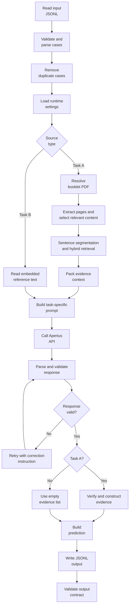

# End-to-End Pipeline

## 1. Overview

The pipeline takes a JSONL file containing claims and their sources, classifies each claim into one of three natural-language inference labels, and writes one prediction per valid input case.

The executable entry point is:

```bash
uv run python -m src.cli \
  --input data/cases.jsonl \
  --output output/predictions.jsonl
```

The CLI coordinates input parsing, duplicate removal, per-case processing, response construction, and output writing. The main per-case orchestration is implemented by `process_case` in `src/pipeline.py`.

## 2. Execution flow



The stages below describe the processing sequence and the information passed between stages.

## 3. Stage-by-stage processing

### Stage 1 — Read and validate input

`src/io_utils.py` reads the input file line by line. Each non-empty line should contain a valid JSON object representing one case.

A case must provide its identifier, vote information, claim, and exactly one source:

- `booklet` for Task A.
- `reference` for Task B.

Malformed JSON and structurally invalid records are logged and skipped. Valid cases continue to processing.

### Stage 2 — Remove duplicate cases

`src/clean.py` normalizes relevant strings and removes duplicate cases while preserving the first case ID.

This prevents repeated inputs from being classified multiple times in the same run. The CLI reports the number of input cases, duplicates removed, and unique cases remaining.

### Stage 3 — Load runtime configuration

The application loads its runtime settings through `src/config.py`. These settings control API access, model inference, timeouts, retrieval-context limits, data paths, and mock mode.

Configuration affects how a case is processed but does not change the input case structure.

### Stage 4 — Resolve the source

The pipeline branches according to the source type.

**Task A:** resolves the booklet path and opens the corresponding PDF. The path must identify a readable PDF within the selected input data layout.

**Task B:** reads the reference passage directly from `case["reference"]["text"]`. No PDF is required.

A missing or unreadable Task A PDF causes that case to enter the per-case failure-handling path.

### Stage 5 — Prepare source context

Task A performs several local processing steps before inference:

1. Extract text from the PDF while preserving physical page numbers.
2. Select relevant pages using vote-title information.
3. Derive section metadata from available document structure.
4. Divide the selected text into sentence-level units.
5. Retrieve relevant units using BM25 and multilingual vector similarity.
6. Combine rankings using reciprocal-rank fusion.
7. Expand neighbouring context where appropriate and pack the selected text within the configured context budget.

The resulting context retains page information to support evidence verification later.

Task B skips these steps. Its supplied reference text is passed directly into the task-specific prompt.

### Stage 6 — Build the prompt and call Apertus

The prompt builder creates the system and user messages for the relevant task. The prompt includes the claim and the source context prepared in Stage 5.

The pipeline selects the model according to the task:

| Task | Model identifier |
|---|---|
| Task A | `swiss-ai/Apertus-v1.5-70B` |
| Task B | `swiss-ai/Apertus-v1.5-8B` |

`LLMClient.chat` sends the request through the configured OpenAI-compatible API endpoint. The expected response is structured JSON containing the classification and the task-appropriate evidence field.

### Stage 7 — Parse and validate model output

`src/parsing.py` parses the model response and validates its structure, label, evidence fields, page values, quote lengths, and label/evidence consistency.

The numeric labels are:

| Label | Name | Meaning |
|---:|---|---|
| `0` | `entailment` | The source supports the claim. |
| `1` | `neutral` | The source neither establishes nor contradicts the claim. |
| `2` | `contradiction` | The source conflicts with an essential part of the claim. |

Invalid JSON or schema-incompatible output is not accepted as a successful prediction.

### Stage 8 — Retry malformed responses

If response parsing fails, the pipeline adds a correction instruction and retries once.

If the corrected response is still invalid, or the retry fails, the case follows the configured fallback behaviour. API transport retries are handled separately by the inference client.

### Stage 9 — Post-process evidence

Task A evidence is processed by `src/evidence.py`. Returned quotations are matched against the extracted PDF text, and verified text is associated with its original 1-based page number.

If the model's quote cannot be matched, the pipeline applies its evidence fallback rules. A non-neutral Task A prediction must satisfy the output evidence contract.

Task B does not produce PDF citations. Its final output uses an empty evidence list.

### Stage 10 — Construct and write the prediction

`make_response` constructs the final response record with the case ID, numeric label, label name, evidence list, and usage or timing metrics.

The CLI writes one JSON object per line to the requested output file and flushes output after each case. This format allows predictions to be processed incrementally without loading the entire output file into memory.

### Stage 11 — Validate and evaluate output

After inference, the generated predictions can be checked with the output validator. Evaluation utilities can then compare predictions with reference labels and assess the required evidence fields.

Validation and evaluation are separate from the inference loop: a file being written successfully does not by itself establish that its predictions are correct or that every record satisfies the required output contract.

## 4. Input schema

Each input line contains one case object.

### Task A — Booklet source

```json
{
  "id": "v1.1-row-10-A",
  "vote": "Example proposal",
  "claim": {
    "text": "The proposal changes the law.",
    "language": "en"
  },
  "booklet": {
    "path": "booklets/2025_11_30_de.pdf",
    "language": "de"
  }
}
```

The `booklet.path` value identifies a PDF relative to the selected input data directory. The PDF must be present in the mounted input directory.

### Task B — Reference source

```json
{
  "id": "v1.1-row-10-B",
  "vote": "Example proposal",
  "claim": {
    "text": "The proposal changes the law.",
    "language": "en"
  },
  "reference": {
    "text": "The proposal introduces a change to the law.",
    "language": "de"
  }
}
```

Task B embeds the source text directly in the case. The pipeline does not need to resolve a PDF path.

## 5. Output schema

A prediction follows this general structure:

```json
{
  "id": "v1.1-row-10-A",
  "label": 0,
  "label_name": "entailment",
  "evidence": [
    {
      "page": 4,
      "text": "The proposal introduces a change to the law."
    }
  ],
  "metrics": {
    "input_tokens": 1200,
    "output_tokens": 80,
    "inference_time_ms": 950
  }
}
```

The metric values above are illustrative, not measured results.

Output requirements:

- `label` must be `0`, `1`, or `2`.
- `label_name` must match the numeric label.
- `evidence` is an array in the final prediction.
- Neutral predictions use an empty evidence array.
- Task B predictions use an empty evidence array.
- Non-neutral Task A predictions must contain at least one evidence item after post-processing.
- Each Task A evidence item must have a positive, 1-based page number and non-empty text.
- Metrics must follow the output contract, including non-negative values where required.

The model's response schema and the final prediction schema are not identical: the model returns `evidence: null` for Task B, while the pipeline converts this into an empty array in the final output.

## 6. Task A versus Task B

| Processing stage | Task A | Task B |
|---|---|---|
| Source | `booklet.path` | `reference.text` |
| PDF loading | Required | Skipped |
| Page selection | Vote-title scoring | Not applicable |
| Sentence segmentation | Required for retrieval | Not required |
| Retrieval | BM25 and multilingual vector search | Not required |
| Prompt context | Retrieved, page-marked booklet text | Supplied reference passage |
| Apertus model | 70B | 8B |
| Evidence from model | Required for non-neutral labels | Must be `null` |
| Final evidence | Verified PDF evidence | Empty array |

The shared inference and output components keep both tasks consistent, while source preparation and evidence requirements remain task-specific.

## 7. Important intermediate data structures

During Task A processing, PDF extraction produces a sequence of strings, with each string representing a physical PDF page.

Sentence segmentation produces records conceptually similar to:

```python
{
    "id": "S00042",
    "page": 7,
    "section": "Erste Vorlage — In Kürze",
    "text": "The source sentence.",
    "position": 41
}
```

Retrieval adds ranking information such as `bm25_score`, `vector_score`, and `rrf_score` to sentence records.

Context packing returns an object conceptually similar to:

```python
{
    "text": "...",
    "sentences": [...],
    "truncated": False
}
```

These structures preserve the relationship between retrieved text and its original document location, which is essential for later evidence verification. Exact field availability depends on the implementation at the time of execution.

## 8. Error handling and fallback behaviour

| Failure | Pipeline behaviour |
|---|---|
| Malformed JSONL or invalid case structure | Log and skip the input record. |
| Missing or unreadable Task A PDF | Log the case failure and apply per-case fallback handling. |
| Transient API failure | Retry according to the inference client's configured policy. |
| Invalid model JSON or schema | Make one correction attempt. |
| Repeated response parsing failure | Fall back to a neutral prediction with empty evidence. |
| Unverifiable Task A quotation | Apply the configured evidence fallback rules. |
| Unexpected per-case exception | Log the failure and apply the pipeline's fallback response. |

The inference client supports up to six attempts for selected transient failures, with bounded backoff. Non-retryable client errors are not automatically treated as transient failures.

Fallback responses keep the pipeline running, but they should not be interpreted as successful classifications. When analysing results, distinguish genuine model predictions from cases handled through fallback behaviour.