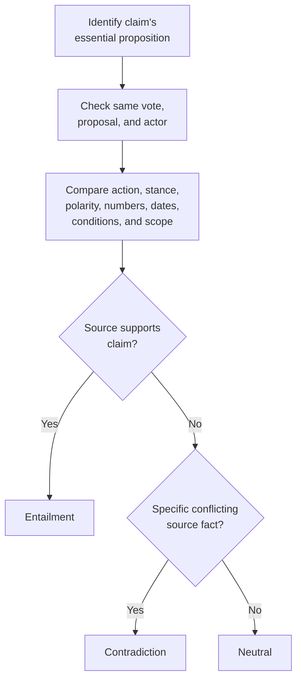

# Classification and Evidence

## At a glance

Both tasks use Apertus to compare a claim with a supplied source. The prompts prioritize **source-grounded reasoning over keyword overlap**.

| | Task A — PDF booklet | Task B — Reference text |
|---|---|---|
| Input | Vote, claim, language, retrieved booklet excerpts | Vote, claim, language, supplied source passage |
| Model | `swiss-ai/Apertus-v1.5-70B` | `swiss-ai/Apertus-v1.5-8B` |
| Core task | Classify and cite source evidence | Classify only |
| Model evidence output | `[{"page": 4, "text": "verbatim quote"}]` | `null` |
| Final evidence | Verified PDF text and 1-based page | `[]` |

## Shared prompt instructions

The shared `RULES` in `src/prompts.py` tell the model to:

- **Use only the supplied source.** Do not rely on outside knowledge or plausibility.
- **Compare meaning, not wording.** Paraphrases and translations can support a claim if the essential meaning agrees.
- **Check essential details:** vote/proposal, actor, action, stance, polarity/negation, quantities, dates, conditions, attribution, and scope.
- **Require a specific conflict for contradiction.** Identify the claim's assertion and the incompatible source fact. Missing information or lack of confirmation is not contradiction.
- **Prefer neutral when unresolved.** If the source is silent, incomplete, ambiguous, or unrelated, do not invent support or conflict.
- **Decide before selecting evidence.** Avoid choosing a label to fit a loosely related passage.
- **Return valid JSON only.** No explanation outside the requested structure.

## Task A: additional evidence instructions

Task A uses `SYSTEM_A`. Its excerpts are **partial retrieved passages**, so the model must search all supplied sentences and confirm that a passage addresses the same proposition—not merely the same keyword, committee, or topic.

<box>

**What Task A emphasizes**

- Check the exact vote and actor; never mix proposals or institutional positions.
- Compare the direction of the claim and source. A source recommending rejection can support a claim that a proposal is unsuitable.
- If no supplied passage addresses the proposition, choose neutral.
- Quote only text present in the excerpts. Do not reconstruct context or combine fragments into a fabricated quote.
- Preserve qualifications, negation, conditions, and attribution in the quote.
- Use the sentence's own `[S... p.n]` page label; page numbers are 1-based. IDs and markers are metadata, not quote text.
- For entailment/contradiction, return **1–4 useful evidence items**. Prefer the smallest set that establishes the decision.
- For neutral, return `"evidence": []`. Each quote must be at most 4,500 characters.

</box>

Expected response:

```json
{
  "label": "entailment|neutral|contradiction",
  "evidence": [
    {"page": 4, "text": "verbatim source sentence"}
  ]
}
```

## Task B: additional instructions

Task B uses `SYSTEM_B` and the complete source passage supplied with the claim. It follows the shared decision rules, but **must not generate evidence or quotations**.

```json
{
  "label": "entailment|neutral|contradiction",
  "evidence": null
}
```

The pipeline normalizes Task B's `null` to `[]` in the final output.

## Decision checklist



## API and recovery

- `LLMClient` in `src/llm_client.py` calls the OpenAI-compatible `chat.completions.create` endpoint with `temperature=0`, task-specific model settings, and JSON Schema output.
- Endpoint: `BASE_URL` (default `https://api.inference.cscs.ch/v1`); authentication uses `API_KEY` or its documented alias.
- Task B's prompt configuration sets `TASK_B_MAX_TOKENS = 100`.
- `MOCK_LLM=1` returns intentionally fake neutral responses for CI checks; it does **not** measure classification quality.
- A malformed response gets one correction attempt. The client separately retries transient API failures with bounded backoff.
- If processing still fails, `_fallback` emits a neutral prediction with empty evidence. This is an operational fallback, not a verified neutral judgment.

## Evidence validation: keep these separate

1. **Schema validity** — response has the required JSON structure.
2. **Quote validity** — Task A quotation matches the original PDF.
3. **Evidence relevance** — the matched passage actually supports the predicted label.

`build_evidence_a` verifies Task A quotes against original PDF text and preserves the source page. If a quote cannot be matched, fallback logic may use a hinted page, a word-overlap page, or the first non-empty page. This preserves output structure but **does not guarantee supporting evidence**.

## Main failure modes the prompts target

| Risk | Prompt safeguard |
|---|---|
| Missing detail treated as contradiction | Require a specific incompatible fact; otherwise prefer neutral |
| Keyword overlap mistaken for support | Check the central proposition and same vote |
| Actor or proposal confused | Verify attribution and proposal identity |
| Direction or negation reversed | Compare polarity and action direction |
| Hypothetical outcome treated as fact | Check conditions and whether the event actually occurred |
| Fabricated or irrelevant citations | Task A must quote supplied text verbatim and use the correct page |
| Explanatory prose breaks output format | Return JSON only |
