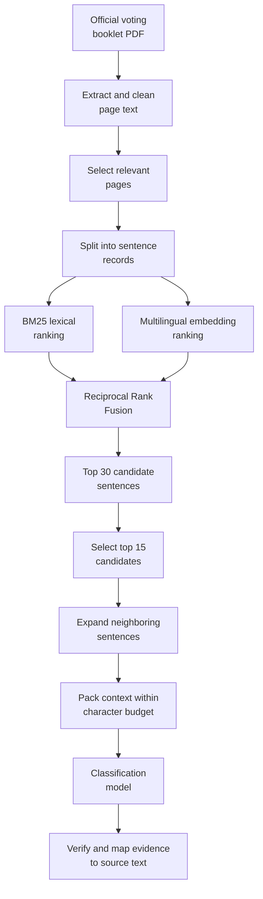

# PDF Extraction and Retrieval

## 1. Overview

Task A retrieves supporting evidence from official Swiss federal voting booklet PDFs. The retrieval system converts each booklet into structured sentence-level records, identifies relevant pages, ranks candidate sentences using lexical and semantic similarity, and assembles a context that can be passed to the classification model.

The retrieval pipeline combines **BM25 lexical retrieval** with **multilingual semantic retrieval**. Reciprocal Rank Fusion (RRF) merges both rankings so that the system can benefit from exact term matches and semantic similarity without relying on either ranking alone.

The main stages are:

1. Extract and clean text from the PDF.
2. Select relevant pages using the vote title.
3. Split page text into sentence-level records.
4. Rank sentences using lexical and semantic retrieval.
5. Fuse rankings and select candidate sentences.
6. Expand candidates with neighboring sentences and pack the context.
7. Map model-generated evidence back to the original PDF text.

## 2. Retrieval architecture



PDF extraction and sentence segmentation preserve page and source-position information throughout retrieval. This information allows the system to reconstruct readable context and associate evidence with its original page.

## 3. PDF loading and text cleaning

The `load_pages` function in `src/pdf_loader.py` uses PyMuPDF to extract one text string per physical PDF page. It reads text blocks using `page.get_text("blocks", sort=True)`, ordering them top-to-bottom and then left-to-right. This provides a more stable reading order than treating the complete document as one unstructured text string.

The `_clean` helper applies the following transformations:

- Unicode NFKC normalization.
- Removal of soft hyphens and conversion of non-breaking spaces.
- Joining of words split by line-break hyphenation.
- Normalization of curly quotation marks.
- Collapsing of horizontal whitespace.
- Joining of wrapped lines within paragraphs while preserving paragraph boundaries.

Page arrays are cached to avoid repeated extraction. Physical PDF page indices are converted to human-facing, 1-based page numbers when creating sentence records and evidence. Original page text is retained for subsequent evidence verification.

### Limitations

Text extraction depends on the PDF's text layer and layout. Scanned pages without usable text, complex tables, multi-column layouts, and unusual reading orders may result in missing or incorrectly ordered text. The cleaning process can also incorrectly join words when a hyphen represents a genuine part of the original word.

## 4. Relevant page selection

Before sentence-level retrieval, `select_relevant_pages` in `src/page_scoring.py` scores every page against the case's voting title.

The scoring procedure uses:

- **Exact title matches:** normalized title matches receive a score of `100`.
- **Distinctive title words:** words are weighted using inverse document frequency (IDF) calculated within the booklet.
- **Relevant-page threshold:** pages scoring at least `15` can start relevant page blocks.
- **Neighbor expansion:** adjacent pages scoring at least `5` can expand those blocks.
- **Context expansion:** one additional page is included on either side of selected blocks.
- **Page cap:** the selected set is limited to `15` pages.

If no page reaches the relevance threshold, the system retains the full booklet rather than returning an empty selection.

This stage reduces the amount of text that must be segmented and ranked. However, it relies on the voting title being sufficiently representative of the wording used in the booklet.

### Section metadata

Section labels are optional metadata attached to sentence records. The system first attempts to detect multilingual table-of-contents pages within the first 12 physical pages. When successful, it maps printed page numbers to physical PDF pages and recognizes section headings such as “In Kürze”, “En bref”, and “In breve”.

If table-of-contents processing fails, the system uses recognized PDF bookmarks as a fallback. Section metadata helps describe where evidence originates but is not itself a relevance score.

## 5. Sentence segmentation and source records

The `build_sentence_units` function in `src/sentence_splitter.py` splits each selected page into sentence-level records using sentence-ending punctuation. It protects common abbreviations, including `Dr.`, `Art.`, `z. B.`, `p. ex.`, and multilingual equivalents, to reduce incorrect sentence boundaries.

Each sentence record contains a stable identifier, a physical page number, optional section metadata, the sentence text, and its position in the source sequence.

Example:

```python
{
    "id": "S00001",
    "page": 3,
    "section": "Erste Vorlage — In Kürze",
    "text": "Sentence copied from the cleaned PDF page.",
    "position": 0,
}
```

The `position` field preserves the sentence's order within its source sequence. Sentence IDs support deduplication, retrieval ranking, context assembly, and evidence traceability.

Sentence segmentation is punctuation-based rather than language-model-based. Unrecognized abbreviations, headings, lists, and language-specific typography can therefore produce incorrect boundaries.

## 6. Hybrid lexical and semantic retrieval

`HybridRetriever` in `src/retrieval.py` creates two independent rankings of the sentence records. Both rankings use the claim and associated case information as retrieval input.

### 6.1 Lexical retrieval: BM25

The lexical retriever uses a repository implementation of BM25 with:

- \(k_1 = 1.5\)
- \(b = 0.75\)

BM25 rewards terms that are informative for a query while accounting for their frequency in a sentence and the length of that sentence relative to the collection.

Tokenization preserves numbers, dates, punctuation-separated numeric forms, and multilingual negation terms. This is useful for voting booklets, where details such as dates, monetary amounts, named actors, and negation can determine whether a claim is supported or contradicted.

Lexical retrieval can nevertheless over-rank sentences that share common vote terminology, names, or numbers without expressing the same proposition.

### 6.2 Semantic retrieval: multilingual embeddings

The semantic retriever uses `paraphrase-multilingual-MiniLM-L12-v2`, loaded from the local model directory.

Document sentences and queries are encoded with `normalize_embeddings=True`. The resulting normalized vectors are compared using dot products, which behave like cosine similarity for normalized vectors.

Semantic retrieval can identify relevant sentences when the claim and source use different wording or languages. However, semantic similarity does not guarantee logical entailment: sentences with similar topics may differ in negation, quantities, dates, or the actors involved.

### 6.3 Model loading and caching

The embedding model is loaded lazily when retrieval is first requested. Document embeddings are cached for the lifetime of the retriever to avoid recomputing them for repeated queries against the same sentence collection.

During local execution, if the configured model path is not a directory, the retriever can download and save the configured multilingual model. Docker disables Hugging Face network fallback using:

```text
HF_HUB_OFFLINE=1
TRANSFORMERS_OFFLINE=1
```

Consequently, the model must be present in the expected local directory before an offline Docker run.

## 7. Ranking fusion and candidate selection

Lexical and semantic rankings are merged using **Reciprocal Rank Fusion (RRF)**. Instead of combining raw BM25 scores and embedding similarities directly, RRF combines the rank positions assigned by each retrieval method.

The fused score for a sentence is calculated as:

```text
RRF(d) = Σ [w_r / (K + rank_r(d))]
```

Here:

- `d` is the candidate sentence.
- `r` represents a retrieval ranking, either lexical or semantic.
- `w_r` is the weight assigned to that ranking.
- `rank_r(d)` is the position of sentence `d` in ranking `r`.
- `K` is the RRF constant, configured as `60`.

The default ranking weights are:

| Retrieval method | Weight |
|---|---:|
| Lexical (BM25) | `1.0` |
| Semantic (embeddings) | `1.0` |

Each ranking contributes more to sentences appearing near its top. RRF combines these contributions, allowing a sentence to rank highly when it performs well in either or both retrieval methods.

Candidates are sorted by descending fused score, with original sentence order used to break ties. The retriever returns the top `30` candidates, and the pipeline passes the first `15` to context packing.

## 8. Context assembly and character limits

The `pack_top_k_context` function in `src/chunking.py` turns ranked sentence candidates into readable source context.

For each selected sentence, it expands the selection by one neighboring sentence on either side (`radius=1`). Expansion remains on the same page and does not cross gaps in source positions.

The packing process:

1. Selects the highest-ranked candidates supplied by the pipeline.
2. Adds eligible neighboring sentences.
3. Deduplicates sentences by ID.
4. Restores original source order.
5. Renders page and sentence markers.
6. Adds context while respecting the configured character budget.

Rendered context uses markers such as:

```text
[[PAGE 3]]
[S00001 p.3] Sentence from the voting booklet.
[S00002 p.3] Following sentence from the same page.
```

The default `MAX_INPUT_CHARS` budget is `600000`. Context that would exceed the budget is skipped, and the `truncated` state is recorded. The pipeline logs a warning when truncation occurs.

Neighbor expansion provides local context that may be necessary to interpret a sentence correctly. However, expansion can add text that is less relevant to the claim, and a strict character budget can exclude a decisive passage.

## 9. Evidence mapping and verification

After classification, `PageIndex` in `src/evidence.py` maps model-generated evidence back to the original PDF text.

The verification procedure normalizes quotes and page text by converting them to lowercase alphanumeric characters. This makes matching tolerant of differences in case, whitespace, punctuation, and PDF hyphenation.

When a quote matches, the evidence builder returns a span from the original page text rather than relying solely on the model's reconstructed wording. A hinted page is checked first.

At most five evidence items are emitted, with a roughly 4,500-character limit per item.

### Evidence fallback behavior

If a required non-neutral quote cannot be found, the evidence builder attempts the following fallbacks:

1. Check the model's hinted page.
2. Find a page with the best overlap.
3. Use the first non-empty page as a final fallback.

These fallbacks help preserve the expected output structure, but they do not guarantee that the resulting text supports the predicted label. Evidence generated through fallback paths should therefore be inspected during evaluation. A structurally valid prediction is not necessarily a semantically correct prediction.

## 10. Main retrieval parameters

| Parameter | Default | Purpose |
|---|---:|---|
| Exact title match score | `100` | Prioritizes pages containing the normalized vote title |
| Relevant-page threshold | `15` | Allows a page to start a selected block |
| Neighbor-page threshold | `5` | Allows adjacent pages to expand a block |
| Maximum selected pages | `15` | Limits page selection |
| BM25 \(k_1\) | `1.5` | Controls term-frequency saturation |
| BM25 \(b\) | `0.75` | Controls document-length normalization |
| RRF constant | `60` | Controls rank contribution decay |
| Lexical weight | `1.0` | Controls lexical ranking contribution |
| Semantic weight | `1.0` | Controls semantic ranking contribution |
| Retrieved candidates | `30` | Number of fused candidates returned |
| Candidates passed to packing | `15` | Initial context selection size |
| Neighbor radius | `1` | Number of neighboring sentences considered on each side |
| `MAX_INPUT_CHARS` | `600000` | Maximum packed context length |
| Maximum evidence items | `5` | Limits emitted evidence items |
| Evidence item character limit | About `4500` | Limits individual evidence length |

These values describe the current configuration and should be changed only after evaluating their effects on retrieval quality, context size, runtime, and evidence validity.

## 11. Known limitations and improvement opportunities

The current retrieval design has several predictable failure modes.

| Risk | Potential effect | Possible improvement |
|---|---|---|
| Scanned or poorly structured PDFs | Missing or misordered source text | OCR and layout-aware extraction |
| Incorrect sentence boundaries | Evidence split across records | Language-aware segmentation |
| Abbreviated or translated vote titles | Relevant pages missed | Query expansion using vote metadata |
| Full-booklet fallback | Higher retrieval cost and noisier candidates | Improve page-selection recall |
| Shared terms or numeric values | Irrelevant lexical matches | Add claim-specific numeric and negation features |
| Similar wording but different meaning | Semantically related yet incorrect evidence | Cross-encoder reranking and contradiction-aware features |
| Page and context caps | Decisive evidence omitted | Adaptive page selection and context budgets |
| Exact quote verification | Valid paraphrases rejected | Improve quote alignment while preserving source traceability |
| Evidence fallback | Weak evidence associated with a prediction | Record fallback usage and evaluate evidence quality separately |

The most useful next step is to measure retrieval recall against known gold evidence before changing thresholds or ranking weights. This can show whether errors originate in PDF extraction, page selection, sentence retrieval, context packing, or the classifier itself.

Retrieval quality and classification quality should be evaluated separately: a classifier cannot reliably use evidence that the retrieval stage never provides, while a highly ranked passage does not automatically establish entailment or contradiction.