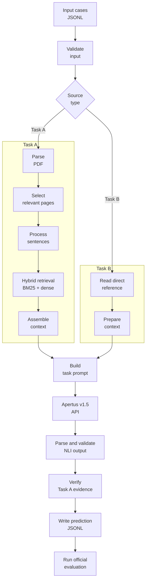
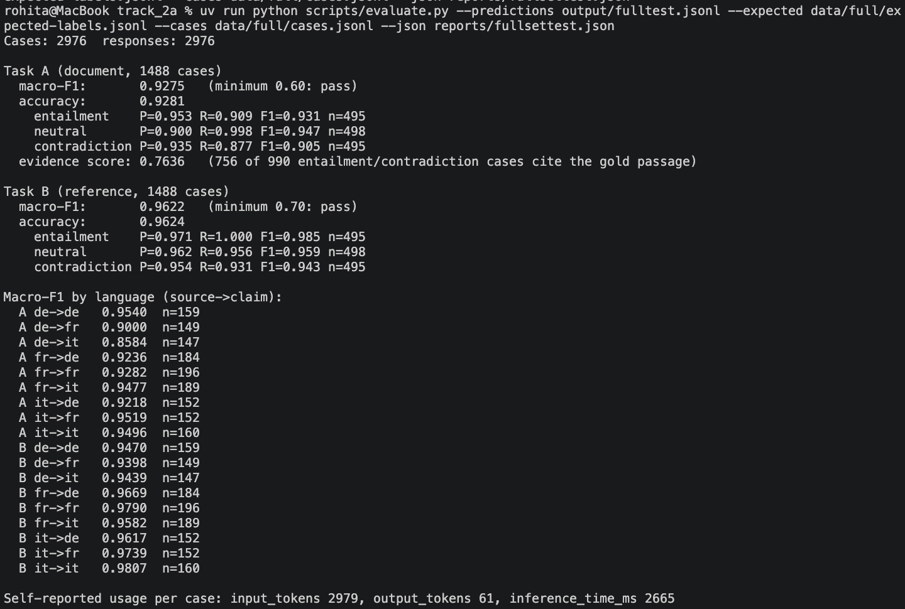

# Technical Report — Multilingual NLI over Swiss Voting Booklets

- **Track:** Track 2A — OST: Multilingual Natural Language Inference over Swiss Official Voting Booklets
- **Event:** HackApertus — Online
- **Team:** `OpenAlps` — `Rohita`
- **Repository:** `https://github.com/rohIta-k/OpenAlps`

## 1. Summary

This project addresses multilingual Natural Language Inference (NLI) over Swiss official voting booklets. Given a claim and its associated source, the system determines whether the source **entails**, **contradicts**, or is **neutral** toward the claim. The challenge is not simply to classify text, but to identify reliable evidence in lengthy, structured documents containing multiple voting proposals and information across German, French, and Italian.

The solution combines PDF text extraction, proposal-aware page selection, sentence-level processing, hybrid lexical and semantic retrieval, and Apertus v1.5 for structured classification. A separate evidence-verification stage checks model-generated quotations against the original source before predictions are written in the required JSONL format. The central engineering objective is to balance classification quality, evidence reliability, and inference efficiency while keeping the execution reproducible.

## 2. Architecture

The system follows a source-grounded pipeline in which document processing and retrieval prepare the context before Apertus performs the classification.



### Main components

- **Input processing:** Reads cases from JSONL and distinguishes between booklet-based and reference-text cases.
- **Document processing:** Extracts page-level text from PDFs while preserving page information for evidence attribution.
- **Proposal selection:** Narrows the document to the relevant voting proposal before searching for supporting passages.
- **Retrieval:** Combines BM25 lexical retrieval with multilingual sentence embeddings. Reciprocal Rank Fusion combines their rankings.
- **Context assembly:** Selects relevant sentences and surrounding context while retaining source and page identifiers.
- **Classification:** Sends task-specific instructions and source context to Apertus v1.5.
- **Evidence verification:** Checks returned quotations against the original text and maps verified passages to their source pages.
- **Output and evaluation:** Produces structured predictions and evaluates them using the official Hackstarter evaluator.

Task A requires PDF processing, retrieval, and page-grounded evidence. Task B uses its supplied reference text directly, avoiding unnecessary PDF processing and retrieval.

The implementation is packaged in Docker for a consistent runtime environment. The embedding model is intended to be available locally within the image, while Apertus inference uses the configured API endpoint.

For detailed implementation information, see [Architecture](docs/architecture.md), [Pipeline](docs/pipeline.md), [Retrieval](docs/retrieval.md), and [Classification](docs/classification.md).


## 3. Use of Apertus

Apertus v1.5 was used as the main NLI classifier for both tasks, with the 70B model for Task A and the 8B model for Task B. Its multilingual capabilities helped us reason across claims and source documents written in different languages, even when they expressed the same information using different wording.
- **Models:** `swiss-ai/Apertus-v1.5-70B` (Task A) and `swiss-ai/Apertus-v1.5-8B` (Task B).
- **Inference:** Through the configured Apertus-compatible API.

We experimented with how the context was presented to Apertus. Instead of relying only on isolated sentences, we included relevant surrounding text so the model could interpret statements in context and avoid missing relationships between a claim and the source. This was particularly useful when the meaning depended on surrounding explanations or qualifications.

Prompt design was also important. We explicitly defined the three labels, clarified when missing information should be classified as neutral rather than contradiction, and set clear constraints on the expected response format and length. These refinements helped address inconsistent classifications and malformed outputs encountered during early iterations, while improving the model's ability to identify supporting evidence.

The final approach combines relevant source context with task-specific prompting, allowing Apertus to perform the semantic comparison while the pipeline handles retrieval, output validation, and evidence checks.

See [Classification](docs/classification.md) for implementation details.


## 4. Data

The development dataset is based on **`OSTswiss/MNLIoverSwissVotingBooklets`**, version `v1.1`, distributed under the MIT License.

The dataset contains claims paired with reference text and associated voting-booklet information. The preparation pipeline deduplicates the source records and creates separate cases for the two task types:

- **Task A:** Claim versus the corresponding official voting booklet.
- **Task B:** Claim versus the provided reference text.

After deduplication, the prepared dataset contains 1,153 unique source rows, represented as 2,306 Task A and Task B cases.

The data was divided into development, validation, and test pools using voting-day grouping, with a 40/30/30 split and seed `0`. Grouping by voting day helps prevent related cases from the same voting day from crossing evaluation pools. The committed split manifest records the resulting assignments.

| Pool | Unique source rows |
|---|---:|
| Development | 458 |
| Validation | 372 |
| Test | 323 |
| **Total** | **1,153** |

Only the intended sample data is committed to the repository. Additional downloaded datasets, custom inputs, and non-redistributable material should remain outside the committed sample unless their licensing permits redistribution.

The input format supports relative booklet paths and language metadata. The source PDFs provide the evidence used by Task A, while Task B uses its reference text directly.

See [Data documentation](docs/data/README.md) and the authoritative [split manifest](docs/splits.json) for data preparation and split details.

## 5. Evaluation

The primary evaluation objective is three-way classification across entailment, neutral, and contradiction. The main metric is **macro-F1**, which gives equal weight to each class rather than allowing performance on the most frequent class to dominate the result.

Evaluation is performed using the official `evaluate.py` script provided in the Hackstarter repository. The same official evaluation procedure is used across experiments to maintain consistency.

### Results

| Metric | Baseline Task A (40 cases) | Baseline Task B (100 cases) | Final Task A (1,488 cases) | Final Task B (1,488 cases) |
|---|---:|---:|---:|---:|
| Macro-F1 | 0.8735 | 0.9577 | 0.9275 | 0.9622 |
| Accuracy | 0.9000 | 0.9600 | 0.9281 | 0.9624 |
| Evidence score | 0.4444 (12/27) | N/A | 0.7636 (756/990) | N/A |
| Mean input tokens/case | 28,141.95 | 2,065.05 | 2,978.81* | 2,978.81* |
| Mean output tokens/case | 108.03 | 14.28 | 60.81* | 60.81* |
| Mean inference time/case | 4,492.78 ms | 688.35 ms | 2,664.88 ms* | 2,664.88 ms* |
| Output-contract validation | Passed (40/40) | Passed (100/100) | Passed (2,976/2,976) | Passed (2,976/2,976) |

\* Final-system token and inference-time values are overall averages across all 2,976 cases; task-specific averages were not provided.

The final system improves Task A macro-F1 from 0.8735 to 0.9275 and Task B macro-F1 from 0.9577 to 0.9622. Task A evidence score increases from 0.4444 to 0.7636. 

The complete final evaluation results, including task-wise metrics, per-class performance, language-level scores, evidence scores, and token usage statistics, are available in [`reports/fullsettest.json`](reports/fullsettest.json).

Individual experiment results, language-level metrics, and per-class comparisons are documented in the [`reports/`](reports/) folder.



## 6. Limitations

- **Retrieval depth:** Retrieving too few sentences can miss important qualifications or supporting evidence. However, retrieving too many increases irrelevant context and can distract the classifier from the passage that actually determines the label.

- **Context length:** Isolated sentences may lose the meaning of surrounding explanations, while excessively large contexts can introduce unrelated proposals, repeated information, or conflicting statements from different sections of a booklet.

- **Proposal and page selection:** Narrowing retrieval to a specific proposal reduces noise, but an incorrect proposal match can exclude the relevant evidence entirely. Broadening the search helps recover missed passages but increases the risk of mixing information from different proposals.

- **Lexical and dense retrieval balance:** Lexical retrieval is useful when claims share terminology with the source, but can miss semantically equivalent statements expressed in another language. Dense retrieval helps bridge this gap, although semantically similar passages are not necessarily evidence for the same claim. Relying too heavily on either method can therefore reduce retrieval quality.

- **Classification prompt constraints:** Loose instructions can lead to inconsistent interpretations of entailment, neutral, and contradiction. Conversely, overly restrictive rules, lengthy prompts, or excessive output constraints can make the model miss valid evidence or produce incomplete responses. Prompt length and output limits must leave enough room for both the reasoning task and the required structured answer.

- **Neutral versus contradiction:** Treating every unsupported claim as a contradiction increases false contradiction predictions. Being too conservative, however, can classify explicitly incompatible facts as neutral. The classifier must distinguish an absence of evidence from evidence that directly conflicts with the claim.

- **Evidence extraction and verification:** Strict quotation matching improves traceability but may reject valid evidence because of PDF line breaks, hyphenation, or text extraction differences. More permissive matching can recover these cases, but risks accepting quotations that do not accurately correspond to the original source.


## 7. Reproducibility

The project uses a fixed dataset preparation procedure, a recorded split manifest, explicit model configuration, and a Docker-based runtime.

A judge should:

1. Clone the repository and enter `track_2a/`.
2. Install the required development dependencies using the documented setup.
3. Configure the Apertus API endpoint and API key.
4. Ensure the required embedding-model files are available before building the Docker image.
5. Build and run the solution using the documented Makefile targets.
6. Validate the generated predictions and run the official evaluation procedure.

The evaluation container targets `linux/amd64`. Input data is mounted read-only at `/data`, predictions are written to `/output`, and temporary runtime files may use `/tmp`. The inference container should not require a runtime download of the embedding weights.

Example commands, subject to the current Makefile configuration:

```bash
cd track_2a

# Install dependencies
uv sync

# Run the solution on the default data directory
make run

# Validate predictions
uv run python scripts/validate_output.py \
  --cases data/cases.jsonl \
  --predictions output/predictions.jsonl
```

For custom data stored in a subdirectory, pass the corresponding `DATA` value to the Makefile target. The API key must be configured through the supported environment variables and must not be committed to the repository.

Detailed installation instructions and runtime variables are documented in [Setup](docs/setup.md) and [Configuration](docs/configuration.md).

## 8. Next Steps

1. **Improve proposal selection:** Use table-of-contents entries, proposal titles, and page ranges to identify relevant sections more accurately and avoid retrieving evidence from unrelated proposals.

2. **Analyze Task A errors:** Inspect evidence scores and retrieved passages for incorrect predictions, distinguishing cases where relevant evidence was missed from cases where Apertus received the correct context but predicted the wrong label.

3. **Refine classification prompts:** Analyze label mismatches, especially neutral versus contradiction, to identify errors involving negation, numerical differences, actor attribution, or unsupported claims.

4. **Optimize retrieval and context:** Experiment with retrieval depth, sentence selection, and context length to balance evidence coverage against irrelevant information.

5. **Improve evidence handling:** Reduce quotation and page-reference errors using source-assigned sentence identifiers and more robust text matching.

6. **Implement duplicate-input caching:** Cache inference results for identical inputs to avoid redundant model calls while preserving separate predictions for distinct case IDs. This can reduce inference time and token usage without compromising evaluation coverage.

## License

This project is released under the **Creative Commons Attribution 4.0 International (CC BY 4.0)** license, as specified by the HackApertus project requirements. Third-party datasets, models, and dependencies remain subject to their respective licenses and terms.
